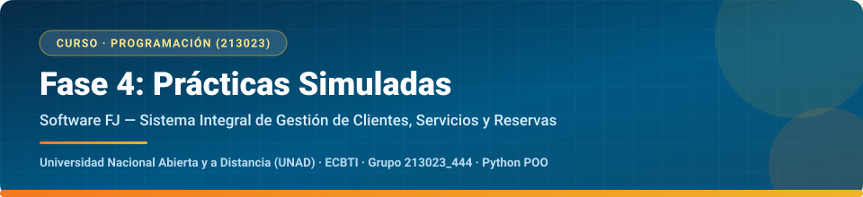

<p align="center">
  
</p>

<p align="center">
  
</p>

<p align="center">
  
  
  
  
</p>

---

## Descripción del Proyecto

Proyecto colaborativo correspondiente a la **Fase 4 – Componente práctico (Prácticas simuladas)** del curso **Programación (213023)** de la **Universidad Nacional Abierta y a Distancia (UNAD)**, Escuela de Ciencias Básicas, Tecnología e Ingeniería (ECBTI), **Grupo 213023\_444**.

La solución implementa en **Python** un sistema integral orientado a objetos para la empresa **Software FJ** (sin base de datos; gestión mediante objetos, listas en memoria y registro de eventos en archivo de logs):

- **Principios de POO (abstracción, herencia, encapsulación y polimorfismo):**
  - Clase abstracta `Entidad` como base común del dominio.
  - Clase `Cliente` con encapsulación de atributos privados, getters/setters y validaciones estrictas de nombre y correo electrónico.
  - Clase abstracta `Servicio` y tres servicios especializados: `ReservaSala`, `AlquilerEquipo` y `AsesoriaEspecializada`.
  - Clase `Reserva` con gestión de ciclo de vida (`PENDIENTE`, `CONFIRMADA`, `CANCELADA`), confirmación, cancelación y procesamiento.
  - Métodos sobrecargados mediante parámetros opcionales (`descuento`, `seguro`, `nivel_senior`, `impuesto`).
- **Manejo robusto de excepciones y auditoría:**
  - Jerarquía personalizada: `ErrorFJ` → `ClienteError`, `ServicioError`, `ReservaError`.
  - Bloques `try/except`, `try/except/else`, `try/except/finally` y encadenamiento de excepciones (`raise ... from e`).
  - Registro automático de operaciones exitosas y errores en `software_fj.log`.

---

## Ejecución

Requiere **Python 3.10+**:

```bash
python README.py
```

Al ejecutarse, el sistema simula **21 operaciones completas** (registros válidos e inválidos de clientes, creación de servicios, reservas exitosas y fallidas, cálculo de costos con descuentos/impuestos y control de estados) sin interrumpir la ejecución, registrando toda la trazabilidad en `software_fj.log`.

---

## Arquitectura del Código (`README.py`)

| Parte | Componente | Descripción |
| :---: | --- | --- |
| **Parte 1** | Excepciones, `Entidad` y Logs | Jerarquía de excepciones personalizadas, clase abstracta base y configuración de `logging` |
| **Parte 2** | `Cliente` | Encapsulación de datos personales, getters/setters y validaciones |
| **Parte 3** | `Servicio` y subclases | `ReservaSala`, `AlquilerEquipo` y `AsesoriaEspecializada` con polimorfismo, sobrecarga y cálculo de costos |
| **Parte 4** | `Reserva` | Integración de cliente y servicio, estados, confirmación, cancelación y procesamiento con encadenamiento |
| **Parte 5** | Simulación, Pruebas y Documentación | Ejecución controlada de 21 escenarios válidos y de error, resumen final y documentación (`README.md`) |

---

## Integrantes — Grupo 213023\_444

| Integrante | Aporte Principal |
| --- | --- |
| **Jhoan Sebastian Cuellar Galindo** | Módulo `Cliente` y configuración inicial del repositorio |
| **Maicol Bocanegra Tavera** | Módulo `Servicio` y clases especializadas |
| **Jorge Peña Ramon** | Módulo `Reserva`, integración y consolidación del informe |
| **Diego Francisco Barrios Salcedo** | Excepciones personalizadas, `Entidad` y configuración de logs |
| **Johnny Muñoz Hernández** (`@darksidesad`) | Parte 5: Simulación, pruebas complementarias (casos 17–21), impuestos, documentación línea por línea y `README.md` |
